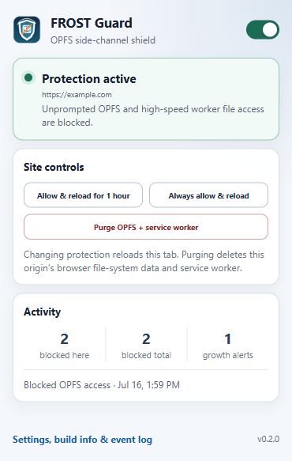
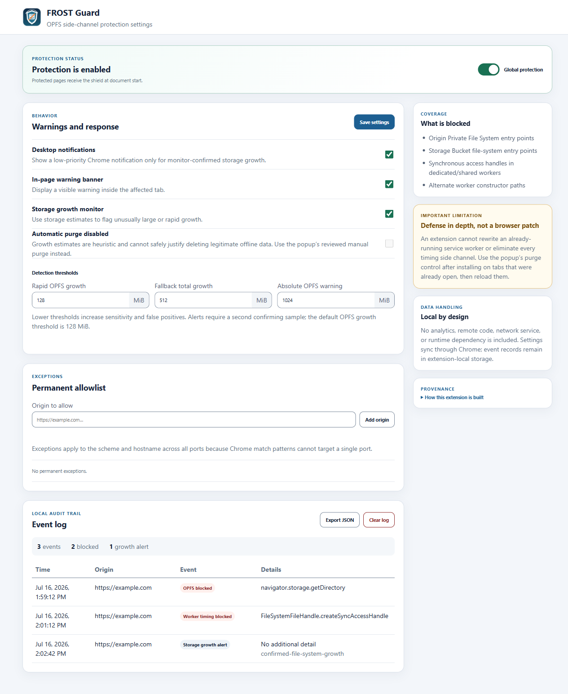

# FROST Guard

FROST Guard is a dependency-free Chrome Manifest V3 extension that blocks and
warns on browser file-system behavior used by **FROST (Fingerprinting Remotely
using OPFS-based SSD Timing)**.

The published FROST technique creates a large Origin Private File System (OPFS)
file, performs timed random reads—typically through a worker—and classifies SSD
contention produced by other websites or native applications. This extension
uses a deliberately strict default: unprompted OPFS entry points are denied
unless the origin is temporarily or permanently allowed.

> **Status:** defensive prototype, version 0.2.0, reviewed 2026-07-14. It is not
> a substitute for a browser-engine fix or a formal security audit.

*As of July 2026, I have yet to come across a website that leverages FROST.*

## Screenshots

### Site popup

<p align="center">
  
</p>

### Settings and event log



## Install

1. Extract the ZIP.
2. Open `chrome://extensions`.
3. Enable **Developer mode**.
4. Select **Load unpacked** and choose the extracted `frostguard` directory.
5. Reload tabs that were already open when the extension was installed.

The extension targets Chrome 120+ and does not download code or contact a
backend.

## What it does

### Thwarts the documented attack path

At `document_start`, the extension injects a main-world shield into every
protected HTTP(S) frame. It denies:

- `navigator.storage.getDirectory()` / `StorageManager.getDirectory()`
- `StorageBucket.getDirectory()`
- `FileSystemFileHandle.createSyncAccessHandle()`
- Future/experimental `FileSystemFileHandle.createAccessHandle()` when present

It also wraps `Worker` and `SharedWorker` so the same denial is installed before
the original worker script executes. The alternate
`Worker.prototype.constructor` path is locked as well.

### Detects and warns

- A closed-shadow-root warning banner appears in the affected top-level page.
- The toolbar icon receives a warning badge.
- Optional low-priority desktop notifications are reserved for monitor-confirmed
  storage growth and rate-limited per origin.
- A top-frame isolated monitor samples `navigator.storage.estimate()` and uses
  an offline-calibrated deterministic classifier to confirm sustained rapid
  file-system growth. Fallback total-storage signals remain log-only.
- A local event log can be reviewed or exported as JSON.

### Contains and recovers

The popup supports one-hour and permanent exceptions. It can also delete the
current origin's browser file-system data and service worker, then reload the
tab. Storage-growth alerts never trigger automatic deletion; cleanup remains an
explicit user action.

## Expected compatibility impact

Blocking OPFS can break legitimate browser IDEs, media editors, offline-first
applications, and other storage-heavy web apps. Use a temporary exception first;
make it permanent only for origins you trust. Exception changes require a tab
reload because the shield locks API descriptors for the life of the document.

Worker wrapping preserves module-worker resolution and common classic-worker
relative `importScripts()` behavior. A classic worker that depends on its own
`location.href` being the original network URL may need an exception because
its initial bootstrap URL is a short-lived `blob:` URL.

## Important limitations

A Chrome extension cannot rewrite an already-running website service worker,
reliably eliminate every newly created realm race, or remove every possible
browser timing side channel. An attacker could also pursue a different storage
API or a future browser API. FROST Guard materially blocks the documented OPFS
and synchronous-worker path, but it cannot prove that all variants are
impossible.

For tabs open before installation, use **Purge OPFS + service worker** on any
suspicious origin and reload. See [`docs/THREAT_MODEL.md`](docs/THREAT_MODEL.md)
for the full boundary.

## Permissions

| Permission | Purpose |
| --- | --- |
| `scripting` + HTTP(S) host access | Register document-start main/isolated scripts on web pages. |
| `storage` | Save settings, temporary exceptions, rate limits, and the local event log. |
| `notifications` | Show optional OS-level warnings. |
| `browsingData` | Remove only a selected origin's file-system data and service worker. |
| `tabs` | Read the active origin, reload after policy changes, and inject into tabs open at install time. |
| `alarms` | Prune expired temporary exceptions and keep dynamic registration synchronized. |

## Dependency and maintenance policy

There are **zero runtime dependencies and zero development dependencies**. The
extension uses browser-native APIs and Node's built-in test runner, avoiding a
bundler and dependency supply-chain churn. `package.json` requires Node 24+ for
local validation. Manifest and maintenance metadata are explicitly dated
2026-07-14.

The options page includes a collapsed **How this extension is built** disclosure.
It reads the packaged `manifest.json` and `package.json` directly to show the
version, platform target, implementation, Node requirement, exact npm package
count, reproducible check commands, and research/platform references. This view
is generated locally with ordinary JavaScript; it uses no AI or network service.

Run checks:

```bash
npm run check
```

Replay the committed synthetic calibration corpus:

```bash
npm run calibration:replay
```

The 2026-07-14 public-site screening attempted 130 origins across 13
categories. See [`docs/LIVE_SITE_SCREENING_2026-07-14.md`](docs/LIVE_SITE_SCREENING_2026-07-14.md)
for the protocol, results, limitations, and reproducible artifacts.

Generate a machine-readable corpus summary:

```bash
npm run calibration:report -- fixtures/calibration/public-site-screening-2026-07-14.json
```

Optional local Chromium smoke test:

```bash
npm run smoke:browser
```

The harness auto-detects Playwright Chromium on Windows. Chrome Stable 137+
does not accept command-line loading of unpacked extensions; set `CHROME_BIN`
to Chromium or Chrome for Testing when auto-detection is unavailable.

The smoke test reports a skip when an enterprise `URLBlocklist` prevents all
HTTP(S) navigation in the test browser.

## Code map

```text
manifest.json                 MV3 permissions and entry points
src/main-shield.js            Main-world API and worker interception
src/storage-growth-classifier.js  Deterministic growth classification
src/storage-monitor.js        Isolated storage sampling and classification
src/bridge.js                 Isolated warning and monitor channel
src/service-worker.js         Registration, logging, policy, cleanup
src/popup.*                   Per-site controls
src/options.*                 Settings, exceptions, event log
src/shared.js                 Pure normalization and event utilities
tools/calibration-collect.mjs Clean-profile Chromium trace collection
tools/calibration-replay.mjs  Deterministic calibration replay
tools/calibration-report.mjs  Category, failure, and growth summary
tests/                        Node unit tests
tools/validate.mjs            Static package validation
tools/browser-smoke.mjs       Optional real-Chromium test
docs/                         Architecture and threat model
```

## Research and platform references

- Ars Technica report: https://arstechnica.com/security/2026/05/websites-have-a-new-way-to-spy-on-visitors-analyzing-their-ssd-activity/
- FROST paper: https://hannesweissteiner.com/pdfs/frost.pdf
- Chrome Scripting API: https://developer.chrome.com/docs/extensions/reference/api/scripting
- Chrome content scripts: https://developer.chrome.com/docs/extensions/develop/concepts/content-scripts
- Chrome Browsing Data API: https://developer.chrome.com/docs/extensions/reference/api/browsingData
- OPFS overview: https://developer.mozilla.org/docs/Web/API/File_System_API/Origin_private_file_system

## License

MIT. See [`LICENSE`](LICENSE).
